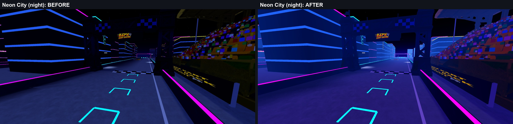
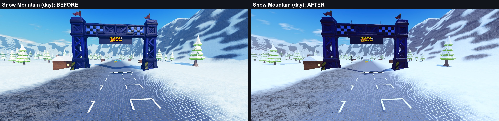
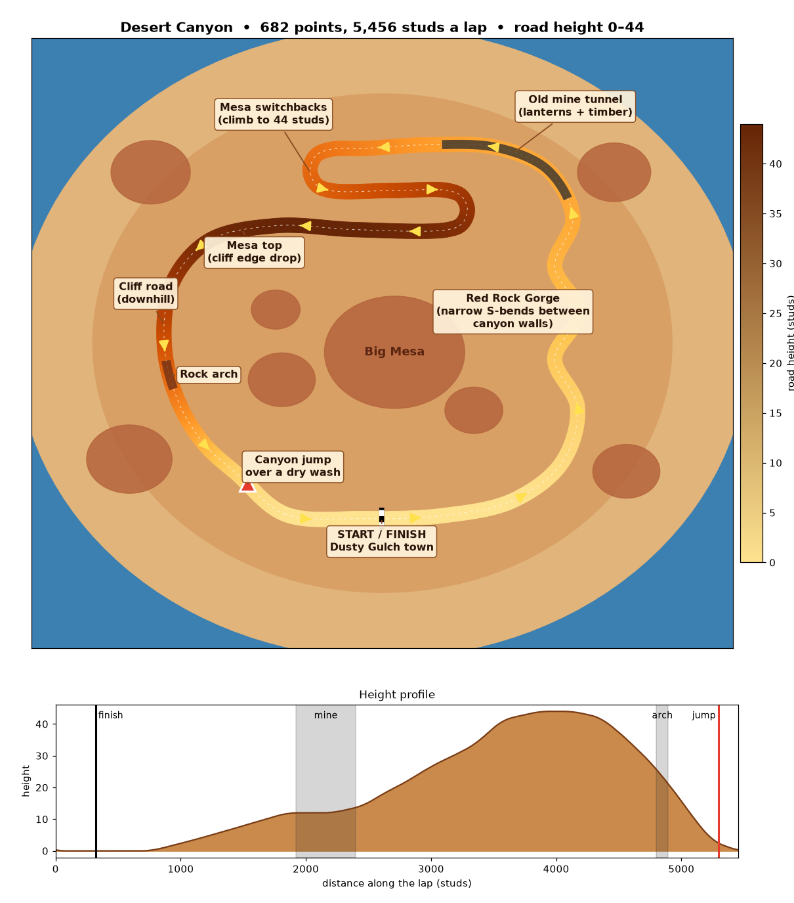

# EZPZ Kart Racing

A multiplayer arcade kart racer on Roblox, written in Luau.

**▶ Play it:** https://www.roblox.com/games/101855942310096

This repository is a **showcase**. It has the design notes and a handful of complete modules from the game. The full
game (about 60 scripts, roughly 17,000 lines) lives in a private repo.

## What's in the game

- **4 tracks, each with a day and a night version:** EZPZ Circuit, Snow Mountain (ice cave, ski village, frozen lake),
  Desert Canyon (mine tunnel, mesa switchbacks, rock arch) and Neon City (a night street circuit with a raised skyway).
  Every island is generated from a racing-line spline: the terrain, walls, gates, pickups and scenery are built from
  the same path data.
- **3 game modes:** Race; **Drift King**, ranked by server-scored drift points with combos; and **Time Attack**, where
  you race a recorded ghost of your own best lap.
- **Up to 8 racers**, with AI bots filling the grid to 6. Players vote for the next track in the lobby.
- **Items:** rockets that follow the track, bananas (a trailing banana works as a shield), shockwave, magnet, decoy
  clones, boost pads, drafting and mini-turbo drift boosts.
- **Progression:** XP and levels, a 7-day login streak, daily and weekly quests, 17 badges, 14 global leaderboards and
  a lobby Hall of Fame.
- **Economy:** coins paid at the finish line, an 8-category cosmetic shop with a lobby showroom for your kart,
  Robux coin packs and a VIP pass.
- **Friends rooms:** private races with host-picked track, laps and item settings.
- **PC and phones:** a separate touch layout with auto-gas, a brake button and a safe-area HUD.

| Neon City, night | Snow Mountain, day |
| --- | --- |
|  |  |

*(Each is a before/after from a lighting pass that gave every track its own mood.)*

## Engineering highlights

### Kart suspension on stepped terrain — [`KartGround.luau`](src/ReplicatedStorage/KartGround.luau)
Roblox terrain draws a smooth slope but collides like ~1-stud stairs. Flat-bottomed karts got kicked 10–20 studs/s
upward at every step: hundreds of bumps a lap on the mountain track. Instead of touching the ground, karts now **ride
at a fixed height** above a sampled surface: five raycasts, averaged and smoothed with slope prediction. On tracks
with known road heights they ride on the racing line itself. The kart's collider sits above the steps.

**Measured over full laps:** vertical-speed error p99 went from 19.7 to 1.8 studs/s, and bumps over 4 studs/s from
359–545 a lap to 3.

### AI drivers — [`BotDriver.luau`](src/ServerScriptService/BotDriver.luau)
Bots follow the racing line with a forward-only nearest-point window, which stopped them circling in hairpins. They
tuck toward the inside on tight bends, launch off ramps and draft behind other karts.

### Save data that can't be lost or duplicated — [`ProfileStore.luau`](src/ServerScriptService/ProfileStore.luau)
Session-locked DataStore profiles: a server claims a player's profile with a lease token before loading it, retries
saves, and only ever releases its own lock. Two servers can't overwrite each other when a player hops quickly.

### Purchases that never pay twice — [`Monetization.server.luau`](src/ServerScriptService/Monetization.server.luau)
`ProcessReceipt` records each purchase id in the player's saved profile and saves before granting, so a retried
receipt is recognised and never pays again. Tested with a test purchase of each pack and a rejoin.

### Ghost laps — [`Ghosts.luau`](src/ServerScriptService/Ghosts.luau)
Time Attack ghosts are recorded on the client at 10 samples/s, compressed into a string and checked on the server
against a lap the server timed itself before they're kept.

### Procedural terrain — [`SnowTerrainGen.luau`](src/ServerStorage/SnowTerrainGen.luau)
Writes a whole island chunk by chunk with `WriteVoxels` (about 8 s for all of Snow Mountain): road, berms, a lake, an
ice cave and peaks, all driven by the racing line's points and heights.

*Track layouts are designed in Python (spline fitting, grade and corner-radius checks, matplotlib previews) and
the generated path is loaded into the game.*

### Also included
- [`RacingUILayout.luau`](src/ReplicatedStorage/RacingUILayout.luau): a safe-area HUD layout shared by six HUD
  scripts, with a compact mode for phones.
- [`Analytics.luau`](src/ServerScriptService/Analytics.luau): a new-player funnel, store funnels and coin
  sources/sinks for Roblox's Creator Dashboard. Every call is guarded, and Studio test runs keep a log instead.

## Anti-cheat (described, not published)
Players' karts are simulated on their own device, so the server checks what each client reports: a movement
allowance with a burst buffer for lag spikes, off-course and height checks, checks that a reset was obeyed, and a
strike system ending in disqualification and coin take-back. Ghost laps and drift boosts are validated against
server-side timing. The code is kept private on purpose.

## Performance
- Holds 60 FPS on large maps with streaming on. The client holds about 5k of a track's 23k parts at a time.
- Profiling with `ScriptProfilerService` cut client RenderStepped time on the busiest track from 307 to 127 ms per
  6 s, mostly by throttling and distance-culling the animated crowd.

## About this repo
These modules depend on the game's config and services, so they won't run on their own; they're here to read.
© 2026 Ebrahim Mughal. All rights reserved: shown as a portfolio sample, not licensed for reuse.
